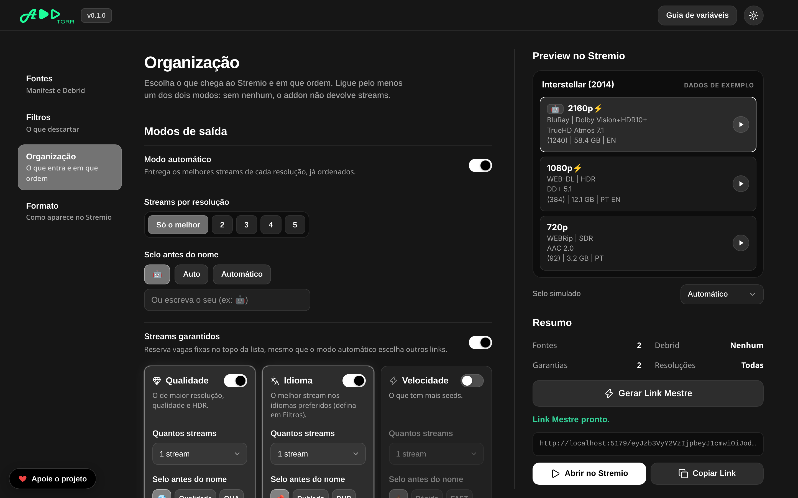

# AddTORR

Addon para [Stremio](https://www.stremio.com/) que junta os streams das suas fontes, remove os repetidos, filtra, ordena e formata o resultado do jeito que você configurar.

O AddTORR não hospeda nem indexa conteúdo. Ele só reorganiza o que as fontes que você adicionou já devolvem.



## O que ele faz

- **Junta várias fontes** em uma lista só e remove torrents repetidos.
- **Filtra** por resolução, HDR, codecs de vídeo e áudio, idioma, tamanho, seeds, 3D e cache no Debrid.
- **Ordena** por qualidade, idioma e seeds, na prioridade que você escolher.
- **Reserva vagas** no topo da lista para o melhor stream em qualidade, idioma e velocidade.
- **Formata** o texto de cada stream com variáveis e modelos prontos, com preview ao vivo.
- **Marca o que está em cache** no Real-Debrid, AllDebrid ou TorBox (opcional).

## Como usar

1. Abra o configurador (a página inicial da sua instância).
2. Em **Fontes**, cole o link `manifest.json` do seu agregador. Deixe o agregador devolvendo o máximo de resultados e sem filtros: o AddTORR faz a filtragem.
3. Ajuste **Filtros**, **Organização** e **Formato**.
4. Clique em **Gerar Link Mestre** e depois em **Abrir no Stremio**.

Toda a configuração fica dentro do próprio link. O servidor não guarda nada.

## Sua chave Debrid

A chave Debrid, quando informada, vai dentro do link de instalação em Base64. Base64 não é criptografia: quem tiver o link consegue ler a chave. Por isso:

- não compartilhe o seu link de instalação;
- se o link vazar, gere uma chave nova no serviço Debrid.

O servidor usa a chave só para consultar o cache no Debrid e não a grava em log.

## Rodar localmente

Requer Node.js 20 ou mais novo.

```bash
npm install
```

```bash
npm start
```

O configurador abre em `http://localhost:5179`.

## Publicar na Vercel

O projeto já está no formato que a Vercel entende: os arquivos de `public/` são servidos como site estático e os de `api/` viram funções. Basta importar o repositório na Vercel, sem configuração extra. As rotas do addon estão em `vercel.json`.

## Estrutura

| Caminho | O que é |
| --- | --- |
| `public/index.html` | Configurador |
| `public/guide.html` | Guia de variáveis e modelos |
| `public/css/`, `public/js/`, `public/fonts/` | Estilos, tema claro/escuro e fontes |
| `api/manifest.js` | Manifesto do addon |
| `api/stream.js` | Busca nas fontes, filtros, ordenação e formatação |
| `server.js` | Servidor local (Express) com as mesmas rotas da Vercel |
| `docs/como-funciona.md` | Passo a passo de como os streams são processados |

## Limites e segurança

- Só são aceitas fontes em `https` e em endereços públicos.
- No máximo 10 fontes por link.
- Cada fonte tem 8 segundos para responder; as que demoram mais são ignoradas.

## Aviso

O AddTORR é uma ferramenta de organização. Ele não fornece, hospeda ou distribui nenhum conteúdo, e não é afiliado ao Stremio nem a nenhum agregador ou serviço Debrid. Você é responsável pelas fontes que adiciona e pelo uso que faz delas, de acordo com as leis do seu país.

## Créditos

- Ícones: [Lucide](https://lucide.dev/) (licença ISC).
- Fontes: [Arimo](https://fonts.google.com/specimen/Arimo) e [Noto Sans](https://fonts.google.com/noto/specimen/Noto+Sans) (SIL Open Font License; textos em `public/fonts/`).

## Licença

[MIT](LICENSE)
